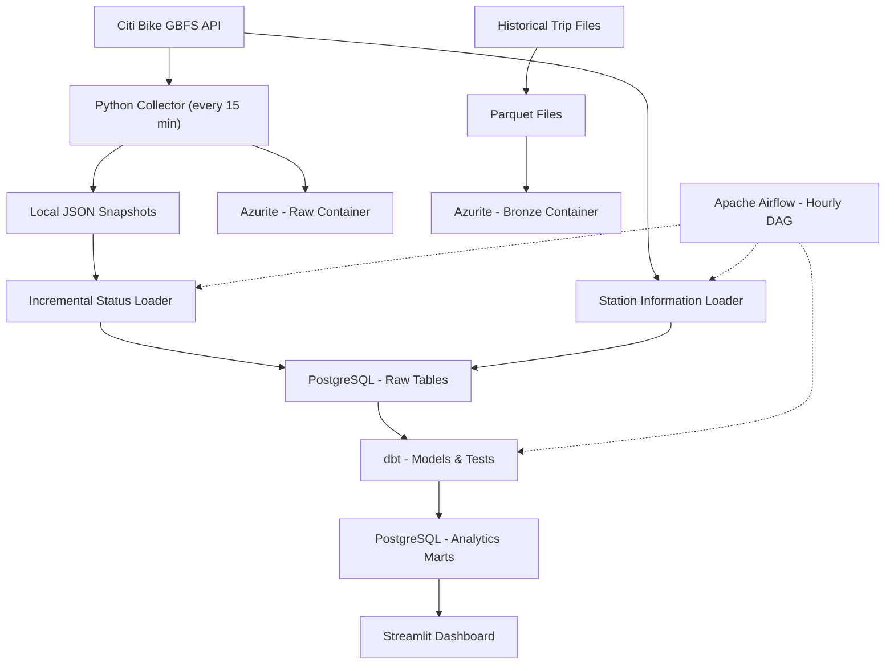
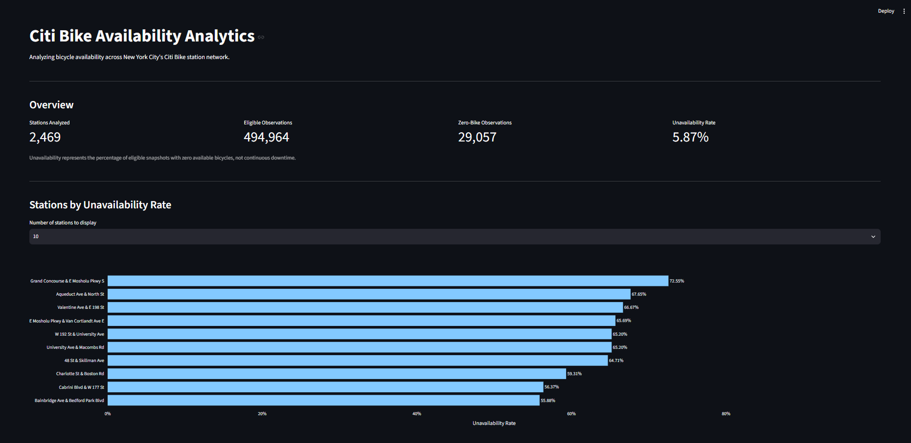
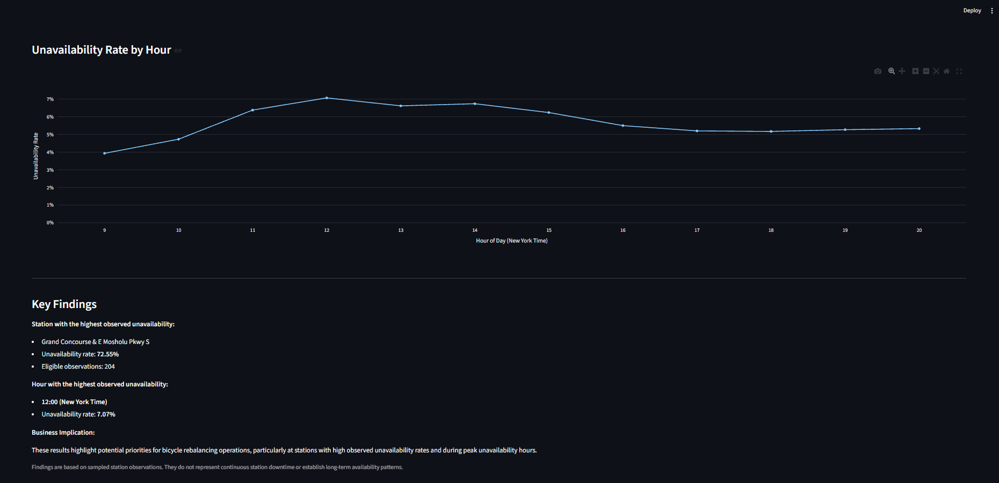
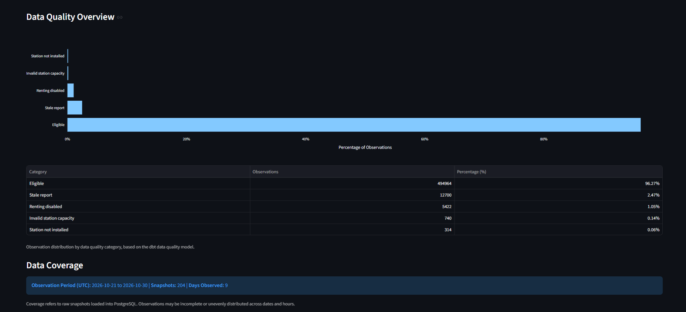

# Urban Mobility Data Engineering Pipeline

An end-to-end **Data Engineering project** using **Python, Docker, PostgreSQL, dbt and Apache Airflow** to automate Citi Bike station data ingestion, processing, validation and analytics. Historical trip data is processed separately into Parquet files and stored in an Azure-compatible local data lake.

## Business Objective

**Which Citi Bike stations experience the highest bicycle unavailability rates and during which hours does this occur most frequently?**

The pipeline supports analysis of station availability and potential rebalancing needs using historical observations, rather than continuous downtime measurements.

## Data Sources

- **Citi Bike GBFS API:** Station reference information and availability snapshots.
- **Citi Bike Trip Histories:** Historical trip records distributed as compressed CSV files.

Source: [Citi Bike System Data](https://citibikenyc.com/system-data)

## Technology Stack

| Technology | Purpose |
|---|---|
| Python, Pandas & PyArrow | API ingestion and batch-to-Parquet processing |
| PostgreSQL | Raw storage and analytical data warehouse |
| dbt Core | SQL transformations, documentation and data quality tests |
| Apache Airflow | Workflow scheduling and orchestration |
| Docker & Docker Compose | Local services and reproducible infrastructure |
| Azure Blob Storage SDK & Azurite | Cloud-compatible object storage and local emulation |
| Streamlit & Plotly | Interactive analytics dashboard |
| pytest | Python unit testing |
| GitHub Actions | Continuous Integration |

## Data Architecture



The Airflow workflow processes **locally stored snapshots**; Azurite holds object-storage copies. Historical trip Parquet files are **not currently loaded into the PostgreSQL/dbt analytics flow**.

## Data Ingestion & Incremental Processing

- Collects GBFS station snapshots **every 15 minutes**, saving JSON locally and uploading it to the Raw container.
- Updates station reference data and incrementally loads new or incomplete snapshots into PostgreSQL.
- Uses the `raw.station_snapshot_loads` ledger and PostgreSQL transactions for **idempotency and recovery**.
- Processes **3,860,371 historical trips** from four CSV files into compressed Parquet, validating non-null, unique ride IDs.

## Data Warehouse & dbt

PostgreSQL and dbt implement a **Raw → Staging → Intermediate → Marts** transformation flow:

- **Staging:** `stg_station_information`, `stg_station_status`
- **Intermediate:** `int_station_availability` (station joins, operational eligibility and data freshness)
- **Analytics:** `mart_station_unavailability`, `mart_hourly_unavailability`, `mart_station_data_quality`

**Data quality:** 30 automated tests cover identifiers, uniqueness, referential integrity, operational values, snapshot reconciliation and model consistency. The data quality mart tracks eligible and excluded observations, including stale reports and inactive stations. dbt also provides model documentation and lineage.

### Example Analytical Results

In a previously analyzed snapshot sample:

- **294,879** station observations were processed.
- **97.16%** met the eligibility rules.
- **5.68%** of eligible observations reported zero available bicycles.

These are **historical sample results, not live metrics**. Snapshot-based rates do not represent continuous station downtime or establish long-term trends.

## Pipeline Orchestration with Apache Airflow

The hourly DAG runs three dependent tasks:

1. `load_station_information` — Update station reference data.
2. `load_station_status` — Incrementally load station snapshots.
3. `build_dbt_models` — Execute dbt models and automated tests.

Airflow provides **task dependencies, retries, execution timeouts, failure logging and UI monitoring**. Manual and scheduled DAG runs were validated successfully, including **6 dbt models and 30 tests**.

## Cloud-Ready Storage — Azure Blob Storage

The Azure Blob Storage SDK connects to **Azurite** for cost-free local development:

- **Raw:** JSON station snapshots.
- **Bronze:** Four historical trip Parquet files.
- **Reliability:** Environment-configured connections and containers, uploads without overwriting existing blobs and **SHA-256 integrity checks**.

All four Parquet files passed local-versus-blob SHA-256 verification. The code supports Azure Blob Storage connection configuration, but **deployment to Azure has not been performed**.

## Analytics Dashboard — Streamlit

An interactive Streamlit dashboard connects to PostgreSQL analytical marts to answer the project's business question.

**Key Features:**
- Availability KPIs and overall unavailability rate
- Interactive Top N stations by unavailability rate
- Hourly availability analysis using Plotly
- Automated business insights and key findings
- Data quality monitoring and observation coverage

Results are based on sampled station snapshots, not continuous downtime.

### Dashboard Preview



<details>
<summary><strong>Additional Dashboard Views</strong></summary>

#### Hourly Analysis & Key Findings



#### Data Quality & Coverage



</details>

## Continuous Integration — GitHub Actions

GitHub Actions automatically validates the Python code on every push and pull request.

- **Python 3.13** syntax validation
- **pytest:** 4 automated unit tests for business metric calculations
- **CI Validation:** Successfully executed on GitHub
- **dbt:** 30 data quality tests executed separately during pipeline runs

## Setup & Execution

**Prerequisites:** Docker Desktop and Git; Python 3.13 for running scripts locally.

1. Clone the repository:

   ```powershell
   git clone https://github.com/miguelnevesaraujo/urban-mobility-data-pipeline.git
   cd urban-mobility-data-pipeline
   ```

2. Copy `infra/.env.example` to `infra/.env` and replace the placeholder values with working PostgreSQL and Azurite settings:

   ```powershell
   Copy-Item infra/.env.example infra/.env
   ```

3. Build and start the services:

   ```powershell
   docker compose --env-file infra/.env -f infra/compose.yaml -f infra/compose.airflow.yaml up -d --build
   ```

4. Access **Airflow** at `http://localhost:8081`. The collector runs every 15 minutes; the Airflow pipeline is scheduled hourly.

**Note:** PostgreSQL tables are automatically initialized on first startup. Historical Bronze Parquet uploads are managed separately from the hourly Airflow DAG. The project runs locally with Azurite, without requiring an Azure subscription.

### Analytics Dashboard

Run the Streamlit dashboard locally:

```powershell
python -m venv .venv
.\.venv\Scripts\Activate.ps1
python -m pip install -r requirements.txt
python -m streamlit run src/dashboard/app.py
```

Access the dashboard at `http://localhost:8501`.

The dashboard requires PostgreSQL and a successful Airflow pipeline execution to populate the dbt analytical models.

## Documentation

- [Data Contract](docs/data_contract.md)

## Development Roadmap

- 1. Project Setup & Architecture
- 2. Data Ingestion & Raw Data Layer
- 3. Data Warehouse & dbt
- 4. Incremental Processing & Data Quality
- 5. Airflow & Pipeline Orchestration
- 6. Cloud Integration & Portfolio