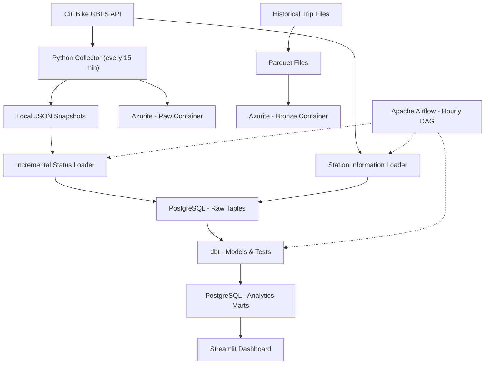

# Urban Mobility Data Engineering Pipeline

[](https://github.com/miguelnevesaraujo/urban-mobility-data-pipeline/actions/workflows/ci.yaml)

An end-to-end **Data Engineering project** using **Python, Docker, PostgreSQL, dbt and Apache Airflow** to automate Citi Bike station data ingestion, processing, validation and analytics. Historical trip data is processed separately into Parquet files and stored in an Azure-compatible local data lake.

## Business Objective

**Which Citi Bike stations experience the highest bicycle unavailability rates and during which hours does this occur most frequently?**

The pipeline supports analysis of station availability and potential rebalancing needs using historical observations, rather than continuous downtime measurements.

## Data Sources

- **Citi Bike GBFS API:** Station reference information and availability snapshots.
- **Citi Bike Trip Histories:** Historical trip records distributed as compressed CSV files.

Source: [Citi Bike System Data](https://citibikenyc.com/system-data)

## Technology Stack

| Technology | Purpose |
|---|---|
| Python, Pandas & PyArrow | API ingestion and batch-to-Parquet processing |
| PostgreSQL | Raw storage and analytical data warehouse |
| dbt Core | SQL transformations, documentation and data quality tests |
| Apache Airflow | Workflow scheduling and orchestration |
| Docker & Docker Compose | Local services and reproducible infrastructure |
| Azure Blob Storage SDK & Azurite | Cloud-compatible object storage and local emulation |
| Streamlit & Plotly | Interactive analytics dashboard |
| pytest | Python unit and integration testing |
| GitHub Actions | Continuous Integration |

## Data Architecture



The Airflow workflow processes **locally stored snapshots**; Azurite holds object-storage copies. Historical trip Parquet files are **not currently loaded into the PostgreSQL/dbt analytics flow**.

## Data Ingestion & Incremental Processing

- Collects GBFS station snapshots **every 15 minutes**, saving JSON locally and uploading it to the Raw container.
- Updates station reference data and incrementally loads new or incomplete (snapshots whose load was interrupted are reprocessed on the next run) snapshots into PostgreSQL.
- Uses the `raw.station_snapshot_loads` ledger and PostgreSQL transactions for **idempotency and recovery**.
- Processes **3,860,371 historical trips** from four CSV files into compressed Parquet, validating non-null, unique ride IDs.

## Data Warehouse & dbt

PostgreSQL and dbt implement a **Raw → Staging → Intermediate → Marts** transformation flow:

- **Staging:** `stg_station_information`, `stg_station_status`
- **Intermediate:** `int_station_availability` (station joins, operational eligibility and data freshness)
- **Analytics:** `mart_station_unavailability`, `mart_hourly_unavailability`, `mart_station_data_quality`

**Data quality:** 30 automated tests cover identifiers, uniqueness, referential integrity, operational values, snapshot reconciliation and model consistency. The data quality mart tracks eligible and excluded observations, including stale reports and inactive stations. dbt also provides model documentation and lineage.

### Key Findings

Based on **220 station snapshots collected between October 21–30, 2026**, covering 9 observed calendar dates:

**Top 5 Stations by Unavailability Rate**

| Station | Unavailability Rate |
|---|---:|
| Grand Concourse & E Mosholu Pkwy S | 74.55% |
| Valentine Ave & E 198 St | 68.18% |
| E Mosholu Pkwy & Van Cortlandt Ave E | 68.18% |
| Aqueduct Ave & North St | 66.82% |
| University Ave & Macombs Rd | 64.09% |

**Hourly Analysis**

The highest observed unavailability occurred between **11:00 and 15:00 (New York Time)**, peaking at **12:00 (7.07%)**.

**Business Insight:** These findings suggest potential priorities for station rebalancing, particularly at frequently empty stations and during midday hours.

**Limitation:** Results are based on periodic snapshots over a limited observation period, not continuous downtime or long-term availability patterns.

## Pipeline Orchestration with Apache Airflow

The hourly DAG runs three dependent tasks:

1. `load_station_information` — Update station reference data.
2. `load_station_status` — Incrementally load station snapshots.
3. `build_dbt_models` — Execute dbt models and automated tests.

Airflow provides **task dependencies, retries, execution timeouts, failure logging and UI monitoring**. Manual and scheduled DAG runs were validated successfully, including **6 dbt models and 30 tests**.

## Cloud-Ready Storage — Azure Blob Storage

The Azure Blob Storage SDK connects to **Azurite** for cost-free local development:

- **Raw:** JSON station snapshots.
- **Bronze:** Four historical trip Parquet files.
- **Reliability:** Environment-configured connections and containers, uploads without overwriting existing blobs and **SHA-256 integrity checks**.

All four Parquet files passed local-versus-blob SHA-256 verification. The code supports Azure Blob Storage connection configuration, but **deployment to Azure has not been performed**.

## Analytics Dashboard — Streamlit

An interactive Streamlit dashboard connects to PostgreSQL analytical marts to answer the project's business question.

**Key Features:**
- Availability KPIs and overall unavailability rate
- Interactive Top N stations by unavailability rate
- Hourly availability analysis using Plotly
- Automated business insights and key findings
- Data quality monitoring and observation coverage

Results are based on sampled station snapshots, not continuous downtime.

### Dashboard Preview


<details>
<summary><strong>Additional Dashboard Views</strong></summary>

#### Hourly Analysis & Key Findings


#### Data Quality & Coverage


</details>

## Continuous Integration — GitHub Actions

GitHub Actions automatically validates the pipeline on every push and pull request.

- **Python 3.13:** Syntax validation
- **pytest:** 5 automated tests (4 unit tests + 1 integration test)
- **PostgreSQL:** Temporary database used during CI
- **dbt:** 6 models and 30 data quality tests
- **Test Data:** Synthetic data used for pipeline validation
- **CI Status:** Successfully executed on GitHub

## Setup & Execution

**Prerequisites:** Docker Desktop, Git and Python 3.13 (for the local dashboard).

### 1. Clone and configure

```powershell
git clone https://github.com/miguelnevesaraujo/urban-mobility-data-pipeline.git
cd urban-mobility-data-pipeline

Copy-Item infra/.env.example infra/.env
```

Edit `infra/.env` and replace `replace_with_local_password` with a password of your choice.

The example configuration includes working Azurite development connection strings. No Azure subscription is required.

### 2. Start the infrastructure

```powershell
docker compose --env-file infra/.env -f infra/compose.yaml -f infra/compose.airflow.yaml up -d --build
```

Verify the services:

```powershell
docker compose --env-file infra/.env -f infra/compose.yaml -f infra/compose.airflow.yaml ps
```

The stack includes PostgreSQL, Azurite, a scheduled GBFS collector and Apache Airflow. PostgreSQL tables are initialized automatically on first startup.

### 3. Run the data pipeline

Open **Airflow** at http://localhost:8081.

To retrieve the locally generated Airflow credentials:

```powershell
docker exec mobility-airflow cat /opt/airflow/simple_auth_manager_passwords.json.generated
```

Once the collector has saved its first station-status snapshot, trigger the `urban_mobility_pipeline` DAG from the Airflow UI.

The DAG runs station reference ingestion, incremental snapshot loading and dbt transformations. It is also scheduled hourly.

The collector fetches GBFS station-status data every 15 minutes independently of Airflow.

### 4. Launch the analytics dashboard

```powershell
python -m venv .venv
.\.venv\Scripts\Activate.ps1
python -m pip install -r requirements.txt
python -m streamlit run src/dashboard/app.py
```

Open **Streamlit** at http://localhost:8501.

The dashboard reads the PostgreSQL analytical marts created by dbt. Run the Airflow pipeline successfully before expecting populated visualizations.

**Notes:**
- Local credentials remain in the untracked `infra/.env` file.
- Historical trip data is stored separately as Bronze Parquet files in Azurite and is not yet part of the operational dbt marts.
- The project runs locally with cloud-compatible storage, without deploying infrastructure to Azure.

## Documentation

- [Data Contract](docs/data_contract.md)
- [Architecture Decisions](docs/architecture-decisions.md)

## Limitations & Next Steps

### Current Limitations

- **Local deployment:** The pipeline runs on Docker with Azurite, demonstrating cloud-compatible storage without an active Azure deployment.
- **Historical trip data:** Citi Bike trip records are stored as Bronze Parquet files but are not yet integrated into the PostgreSQL/dbt analytical models.
- **Snapshot-based availability:** Station availability metrics represent collected observations rather than continuous station downtime.
- **Operational monitoring:** Airflow provides task execution logs and retries, but production-grade alerting and monitoring are not yet implemented.

### Future Improvements

- Integrate historical trip data into the analytical warehouse to explore relationships between trip demand and station availability.
- Introduce automated operational alerts and pipeline health monitoring.
- Deploy the infrastructure to a managed cloud environment.
- Expand automated testing with additional data quality and edge-case scenarios.